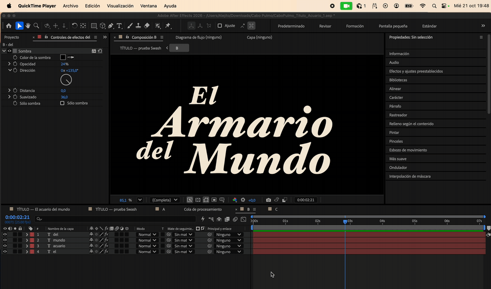

# Floritura

An After Effects plugin for picking OpenType flourishes. It shows the alternates of a selected letter (swashes, stylistic sets, and other variants) and places the one you choose in the composition.

The chosen letter comes in as an outline, still tied to the font and the type size. From the panel you can swap the variant, the letter, or the size. The rest of the word stays live text. The font file is not modified.



## Install

After Effects 2026 loads this as a CEP panel. Restart After Effects the first time.

1. Clone this repository.
2. Symlink it and turn on CEP debug mode:

```
ln -sfn "$PWD" "$HOME/Library/Application Support/Adobe/CEP/extensions/com.alejito.floritura"
defaults write com.adobe.CSXS.11 PlayerDebugMode 1
defaults write com.adobe.CSXS.12 PlayerDebugMode 1
```

3. Restart After Effects.
4. Window → Extensions (Legacy) → Floritura. On some versions the menu is just called Extensions.

The panel itself is in Spanish.

## Use it

1. Select a point-text layer on a single line.
2. Click **Leer capa**. If the font is not found, click **Elegir fuente…** and point at the `.otf` or `.ttf`.
3. Click a letter and pick a variant. The word below shows the result.
4. Click **Colocar en la composición**. The word moves into its own composition, the same size as the current one. Outside, a single layer keeps the fade, the effects, and the motion. Inside are the glyph (the orange layer) and the rest of the text.
5. To change it, select that layer and click **Actualizar letra**. **Volver a texto** removes the glyph and leaves the word inside its composition.

## Limits of this version

- Point text, one line.
- Adobe Fonts files are sometimes not readable on disk. You need the `.otf` or `.ttf`.
- Size, color, and tracking are read from the layer when you place or update. The fade and the effects stay on the outer layer. Change the size from the panel.
